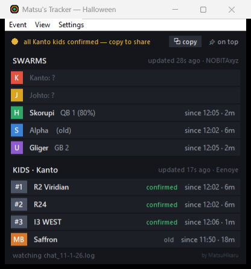

# Matsu's Tracker

A small always-on-top window for PokeMMO that keeps the latest event callouts from chat visible, so you don't have to scroll Global chat or ask "where kids?" every few minutes.

> **All credit goes to the callers.** The tracker doesn't find anything by itself. It's just a visual view of the swarm, KIDS and miniboss callouts that players post in chat.



## What it shows (Halloween)

- **Swarms**: current swarm Pokémon and location for Kanto, Johto, Hoenn, Sinnoh and Unova, with when it was first called out
- **Kanto Kids**: the 3 kid locations, marked confirmed / unconfirmed `(?)` / old
- **Miniboss**: current MB location
- **Freshness**: "updated X ago" per callout, turns red when it goes stale

### Team features

- **Status dot**: turns yellow when a teammate asks in Team chat for kids / MB / swarm locations, or when all 3 kids are confirmed and you haven't shared them yet
- **Copy**: copies a one-line summary that fits in chat, e.g.
  `SW K:Ekans_QB_1 J:Hoot_QB_2 H:? S:Alpha_Electabuzz U:? | MB Saffron | KK Saffron R24 I1_NORTH`

### Other

- Always-on-top toggle and adjustable transparency (View menu)
- Event menu: Halloween now, Christmas and Lunar New Year planned

## How it works

It only **reads** the chat log file that PokeMMO itself writes to your PC.

- No code injection, no memory reading, no client modification
- Doesn't send any input to the game, so there's no automation of any kind
- Doesn't need your login or account info, and nothing is uploaded anywhere

## Install

1. In PokeMMO: **Settings → Chat → turn on "Log chat to disk"**
2. Download `Matsus-Tracker.zip` from [Releases](../../releases/latest), extract it and run **Matsu's Tracker.exe**
3. Windows may say "Windows protected your PC" because the app isn't signed. Click **More info → Run anyway**
4. If PokeMMO is installed somewhere unusual, the app asks you to pick the folder that contains `PokeMMO.exe`

Optional: **Settings → Set my character names…** (it also learns your name from your first wild battle).
Settings are saved in `%APPDATA%\Matsu's Tracker\settings.json`.

## Run from source

Requires Python 3.10+ (standard library only):

```
python tracker.py
```

Build the .exe yourself with `build.ps1` (uses PyInstaller).

## Contributing

If you know the callout formats for the Christmas or Lunar New Year events, open an issue with an example line from chat.

Huge thanks to everyone doing swarm, KIDS and miniboss callouts. You do the real work, and this tracker just puts what you post in one place.

---

Made by **MatsuHikaru**. Not affiliated with PokeMMO.
